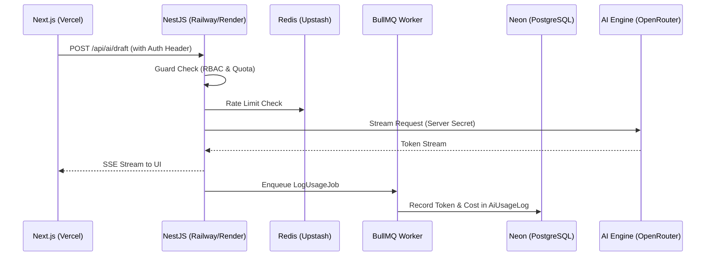

# PRD — Project Requirements Document

## 1. Overview

AniVirtual adalah asisten kerja kontekstual terintegrasi dalam ekosistem KLIR, sistem operasional AI bagi usaha mikro, kecil, dan menengah (UMKM) Indonesia. Berbeda dari chatbot silo generik, AniVirtual dibangun sebagai asisten yang mengenal usaha penggunanya secara utuh — memiliki memori kontekstual pribadi, terhubung langsung ke modul-modul KLIR (KLIR Kerja, KLIR Kas, CorPlan), dan menjaga keamanan tingkat enterprise dengan isolasi data multi-tenant yang ketat.

AniVirtual menjawab masalah komunikasi kerja yang krusial:

- Pesan kerja dari tim (sering WhatsApp-style) sering tidak jelas, membuat penerima harus bertanya ulang atau salah memahami maksud.
- Pengajuan kebutuhan (beli sparepart, bahan) bisa diputus langsung tanpa pertimbangan anggaran dan persetujuan yang terdokumentasi.
- Kontak dan memori pelanggan tidak tersimpan, jadi usaha harus mengulang pertanyaan yang sama.
- Rencana kerja tidak tersusun dan tidak terhubung dengan tugas yang muncul dari percakapan.
- Kunci API AI dikelola secara tidak aman, menyulitkan perusahaan yang ingin memasang AI untuk timnya.

PRD ini menggantikan PRD lama dan mencakup seluruh 11 fitur AniVirtual yang saling terhubung erat. PRD ini juga menjadi fondasi yang kokoh bagi ekosistem: setiap permintaan harus melalui pipeline login, ruang kerja, langganan (membership), hak akses modul, peran, potong kredit AI, pencatatan log, dan kunci AI yang aman di sisi server.

## 2. Requirements

### Fungsional

1. **Paham Pesan Ambigu** — Sistem mampu mendeteksi pesan kerja yang kurang jelas dan menyajikan multi-opsi tafsiran kepada pengguna alih-alih memaksakan satu interpretasi.
2. **Balasan Cerdas Multi-Skenario** — Sistem menyajikan draf balasan siap pakai yang kontekstual dengan opsi variasi gaya/skenario cepat.
3. **Formulir & Manajemen Ajuan Kebutuhan Terstruktur** — Sistem menyediakan form lengkap (nominal, kategori, urgensi, justifikasi) dan alur persetujuan yang rapi.
4. **Penyusun Rencana Kerja & Roadmap** — Sistem memandu pengguna menyusun target kerja mingguan/bulanan yang actionable.
5. **Kartu Kenalan & Memori Kontekstual Pribadi** — Sistem menyimpan preferensi, kebiasaan, dan istilah khusus dengan persetujuan manual terlebih dahulu (human-in-the-loop).
6. **Server-side AI Gateway & Kuota Perusahaan** — Seluruh permintaan AI melewati perantara server; kunci API tidak pernah muncul di sisi klien; ada manajemen kuota dan pencatatan biaya.
7. **RBAC 3-Peran Berjenjang & Keamanan Multi-Tenant** — Validasi server-side untuk peran Pemilik (Owner), Penyetuju (Approver), dan Anggota Biasa (Member) dengan isolasi workspace ketat.
8. **Pemeriksaan Anggaran Otomatis Terhubung CorPlan** — Pengecekan real-time nominal ajuan terhadap batas pagu anggaran CorPlan sebagai panduan approver.
9. **Generator Draf Balasan Alternatif Lanjutan** — Pilihan preset nada lebih luas (krisis, komplain, negosiasi, asertif, santai) untuk kebutuhan situasi beragam.
10. **Penyesuaian Gaya Bahasa Fleksibel (Ad-hoc Tone Modifier)** — Kolom instruksi singkat untuk memodifikasi gaya bahasa balasan secara instan tanpa pengaturan profil rumit.
11. **Integrasi Ekosistem KLIR 2-Arah** — Deteksi tugas dari percakapan dengan konfirmasi 1-klik ke KLIR Kerja, dan sinkronisasi otomatis ajuan disetujui ke KLIR Kas dengan idempotency key.

### Non-Fungsional

- **Zero API Key Leakage di Client** — Kunci API AI hanya tersimpan di server NestJS. Frontend Next.js tidak pernah berkomunikasi langsung dengan penyedia AI.
- **SLA Latensi AI Streaming** — Menggunakan Server-Sent Events (SSE) dari NestJS ke Next.js agar respons AI mulai terlihat dalam < 2 detik.
- **Idempotensi Sinkronisasi** — Setiap sinkronisasi ke KLIR Kas wajib memiliki kunci unik yang dikelola oleh BullMQ processor untuk mencegah duplikasi data.
- **Multi-Tenancy Data Isolation Strictly Enforced** — Data terisolasi di level PostgreSQL (Neon) via Prisma middleware atau RLS, memastikan data pribadi user (`ContactCard`) tidak bocor ke workspace.
- **Audit Logging** — Setiap aksi pengguna dicatat secara asinkron ke tabel `AiUsageLog` menggunakan BullMQ untuk menjaga performa response time.
- **Arsitektur Modular** — Implementasi NestJS Modules untuk memisahkan fitur inti dari logika integrasi ekosistem KLIR.

## 3. Core Features

### Fitur 1: Paham Pesan Ambigu (Multi-Tafsiran & Anti-False Confidence)
**Realisasi:** NestJS AI Service memproses pesan melalui model LLM dengan sistem *system prompt* yang melarang "hallucination". Jika tingkat keyakinan rendah, AI mengembalikan format JSON berisi opsi tafsiran. Frontend Next.js merender opsi ini sebagai tombol interaktif.

### Fitur 2: Balasan Cerdas Multi-Skenario
**Realisasi:** Next.js mengirimkan konteks chat ke NestJS. Backend memanggil AI Gateway untuk menghasilkan 3 variasi draf (SSE Streaming). User memilih salah satu, yang kemudian dikirim via Next.js Server Actions.

### Fitur 3: Formulir & Manajemen Ajuan Kebutuhan Terstruktur
**Realisasi:** Form divalidasi oleh Zod di Next.js, dikirim ke NestJS untuk disimpan di Neon PostgreSQL via Prisma. Status transisi (draft -> pending) memicu event internal.

### Fitur 4: Penyusun Rencana Kerja & Roadmap
**Realisasi:** NestJS mendestrukturisasi input bebas menjadi objek JSON terstruktur (WorkPlanItem) menggunakan AI. Data disimpan di tabel `WorkPlan` menggunakan Prisma.

### Fitur 5: Kartu Kenalan & Memori Kontekstual Pribadi (Human-in-the-loop)
**Realisasi:** Logika deteksi memori berjalan di background worker (BullMQ). Jika ditemukan info penting, entri dibuat di `MemoryApproval`. User melihat notifikasi di dashboard Next.js untuk menyetujui.

### Fitur 6: Server-side AI Gateway & Kuota Perusahaan
**Realisasi:** NestJS bertindak sebagai proxy. Sebelum `fetch` ke OpenRouter, sistem mengecek kuota di Redis (Upstash) menggunakan algoritma *token bucket*. Setelah respons selesai, BullMQ mencatat pemakaian token ke database untuk audit.

### Fitur 7: RBAC 3-Peran Berjenjang & Keamanan Multi-Tenant
**Realisasi:** Penggunaan NestJS `Guards` dan `Decorators` (`@Roles('owner')`) untuk melindungi endpoint API. Setiap query Prisma difilter berdasarkan `workspaceId` dari JWT session.

### Fitur 8: Pemeriksaan Anggaran Otomatis Terhubung CorPlan
**Realisasi:** Saat ajuan dibuat, NestJS memicu BullMQ Job untuk mengambil data anggaran dari CorPlan API, membandingkannya, dan memperbarui tabel `BudgetVerification` secara asinkron agar UI tidak *freeze*.

### Fitur 9: Generator Draf Balasan Alternatif Lanjutan
**Realisasi:** Ekspansi sistem prompt di NestJS AI Service untuk mendukung variasi nada (krisis, komplain, dll) berdasarkan pilihan UI di Next.js.

### Fitur 10: Penyesuaian Gaya Bahasa Fleksibel (Ad-hoc Tone Modifier)
**Realisasi:** Input teks singkat dari user digabungkan ke dalam *prompt template* di sisi backend NestJS sebelum dikirim ke LLM.

### Fitur 11: Integrasi Ekosistem KLIR 2-Arah
**Realisasi:**
- **Task Detection:** NestJS mendeteksi tugas, membuat `TaskSuggestion`. Jika user klik konfirmasi di Next.js, backend memanggil API KLIR Kerja.
- **KLIR Kas Sync:** Menggunakan **Transactional Outbox Pattern**. Prisma menyimpan ajuan + event outbox dalam satu transaksi database. BullMQ Worker memproses event ini secara reliabel dengan *exponential backoff* dan *idempotency key*.

## 4. User Flow
*(Sesuai alur pada dokumen sebelumnya, namun dengan validasi Server-Side yang lebih ketat di setiap langkah)*

## 5. Architecture

### Arsitektur Teknis
AniVirtual menggunakan arsitektur modern berbasis TypeScript yang terpisah antara UI dan Logika Bisnis:

1.  **Frontend (Next.js):** Dihosting di Vercel. Menggunakan App Router untuk routing efisien, Tailwind CSS untuk UI, dan React Query/SWR untuk sinkronisasi state dengan backend. Streaming AI response ditangani melalui integrasi SSE.
2.  **Backend (NestJS):** Dihosting di Railway atau Render. Menggunakan struktur modular. Bertanggung jawab atas autentikasi, otorisasi (RBAC), AI orchestration, dan manajemen antrean.
3.  **Database Layer:** PostgreSQL di Neon (Serverless). Prisma ORM digunakan untuk manajemen skema dan type-safety query.
4.  **Async Logic (Redis + BullMQ):** Redis Upstash digunakan sebagai message broker. BullMQ menangani tugas berat seperti deteksi memori, sinkronisasi outbox ke KLIR Kas, dan logging penggunaan AI secara background.

## 6. Database Schema
*(Tabel tetap sesuai skema sebelumnya, dioptimalkan untuk Prisma ORM dengan index pada `workspaceId` dan `userId`)*

## 7. Tech Stack

| Komponen | Teknologi | Detail Implementasi |
| :--- | :--- | :--- |
| **Frontend** | **Next.js** | App Router, Server Actions, Tailwind CSS, Vercel Deployment. |
| **Backend** | **NestJS** | Modular Architecture, REST/SSE Controllers, Guards untuk RBAC, Railway/Render Deployment. |
| **Database** | **PostgreSQL (Neon)** | Serverless Postgres, Managed Scaling. |
| **ORM** | **Prisma** | Type-safe queries, Migrations, Neon-optimized client. |
| **Caching & Quota** | **Redis (Upstash)** | Upstash Redis untuk Global Rate Limiting & Quota Management. |
| **Antrean & Worker** | **BullMQ** | Background workers untuk Transactional Outbox, Async Logging, & Budget Sync. |
| **AI SDK** | **Server-side SDK** | Vercel AI SDK (Core) atau OpenAI/Anthropic SDK di NestJS backend. |
| **Keamanan** | **JWT & RBAC** | Validasi session fondasi KLIR terpusat. |
| **Integrasi** | **REST & Idempotency** | Komunikasi antar modul KLIR dengan header `Idempotency-Key`. |

## 8. Detail Implementasi Keamanan & Skala

-   **Zero API Key Leakage:** Konfigurasi `.env` hanya ada di Railway/Render. Frontend Next.js hanya memanggil endpoint `/api` internal.
-   **Transactional Outbox:** Menjamin data di KLIR Kas dan AniVirtual konsisten. Jika PostgreSQL sukses menyimpan `ProcurementRequest`, sebuah job di Redis dibuat. BullMQ akan mencoba mengirim ke KLIR Kas sampai sukses (retryable).
-   **Streaming Response:** Menggunakan `Observable` di NestJS dan `ReadableStream` di Next.js untuk memberikan pengalaman AI yang instan bagi pengguna UMKM.
-   **Neon Serverless Hooks:** Memungkinkan database untuk melakukan *scale-to-zero* saat tidak ada aktivitas, menghemat biaya operasional UMKM tanpa mengorbankan performa saat jam kerja.

---
*PRD ini mendefinisikan AniVirtual sebagai sistem asisten cerdas berbasis event-driven yang tangguh, aman, dan terintegrasi secara mendalam dengan infrastruktur modern.*