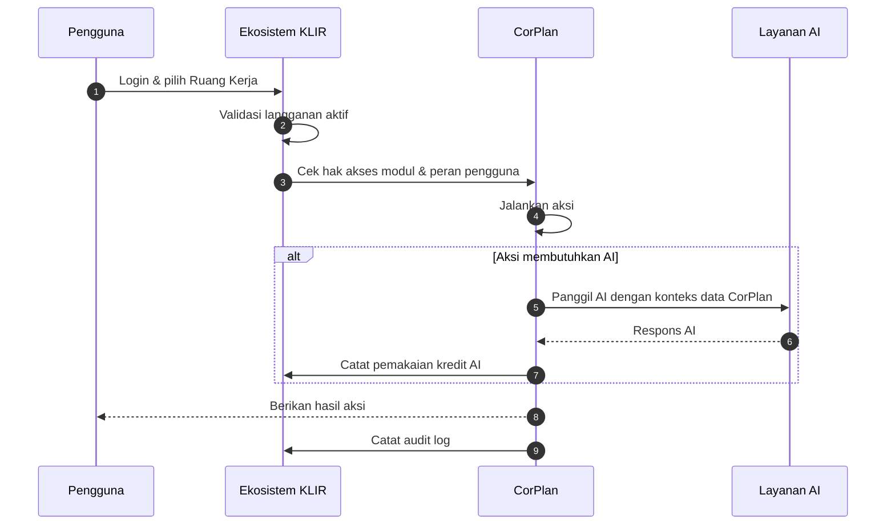

# PRD — Project Requirements Document

**Produk:** CorPlan – Modul Perencanaan Bisnis di Ekosistem KLIR  
**Versi Dokumen:** 2.0 Final  
**Status:** Siap ditinjau implementasi

---

## 1. Overview & Arsitektur Aliran Data

### 1.1 Positioning CorPlan

CorPlan adalah modul perencanaan bisnis di dalam ekosistem KLIR, platform OS bisnis AI untuk UMKM Indonesia. CorPlan menjadi pusat kendali perencanaan bisnis yang memungkinkan pemilik usaha kecil seperti Ibu Sari — pemilik katering rumahan — untuk menyusun proposal KUR, menghitung biaya usaha, menganalisis pasar, menyiapkan materi investor, mengelola legalitas, dan berbagi data dengan modul lain secara terstruktur.

Sebelumnya, Ibu Sari menyusun dokumen usaha dengan cara manual menggunakan Word dan kalkulator. Ia sering mengalami kesalahan format, lupa biaya tersembunyi, dan kesulitan karena data usaha tersebar di banyak file. CorPlan menjawab masalah itu dengan satu prinsip utama: **single source of business truth** — satu sumber kebenaran untuk semua angka dan rencana usaha.

Seluruh fitur CorPlan tidak berdiri sendiri. Data yang dimasukkan di satu fitur otomatis mengisi fitur lain. Hasil kalkulator keuangan mengisi proposal dan pitch deck. Hasil analisis kompetitor mengisi SWOT. Data legalitas melengkapi daftar periksa. Dengan demikian, pengguna tidak perlu mengisi data yang sama berulang-ulang di tempat yang berbeda.

### 1.2 Masalah yang Dipecahkan

- Penyusunan proposal bisnis dan pitch deck masih manual, format tidak standar, dan kurang meyakinkan bagi bank atau investor.
- Perhitungan HPP, biaya operasional, dan titik impas sering dilakukan secara kira-kira sehingga margin dan kelayakan usaha tidak terlihat jelas.
- Analisis pasar, kompetitor, dan legalitas tidak memiliki data terstruktur.
- Data usaha tersebar di banyak file sehingga angka di proposal, kalkulator, dan presentasi investor sering tidak sinkron.
- Pemilik UMKM tidak memiliki akses ke konsultan bisnis profesional karena biayanya mahal.
- Setiap kali berpindah modul dalam ekosistem KLIR, pengguna harus menjelaskan lagi kondisi usahanya dari nol.

### 1.3 Paradigma Single Source of Business Truth

Semua data yang dimasukkan ke CorPlan disimpan dalam basis data ekosistem KLIR dan terikat pada satu **Ruang Kerja**. Tidak ada penyimpanan lokal terpisah. Data tersebut menjadi rujukan bersama untuk:

- Proposal bisnis 6 bab.
- Pitch deck investor 12 slide.
- Kalkulator finansial terpadu.
- Simulasi KUR dan penilaian nilai usaha.
- Analisis kompetitor dan riset tren.
- Kalender konten dan SWOT.
- Daftar periksa legalitas.
- Konsultan AI kontekstual.

Jika pengguna mengubah data di satu tempat, pembaruan tersebut dapat langsung dirujuk oleh fitur lain yang memakai data yang sama. Dengan begitu, semua dokumen yang dihasilkan CorPlan selalu konsisten.

### 1.4 Arsitektur Aliran Data

Seluruh permintaan masuk ke CorPlan melalui fondasi ekosistem KLIR. Tidak ada aksi yang berjalan tanpa melalui lapisan ini.

Setiap data CorPlan memiliki identitas Ruang Kerja. Hak akses pengguna diatur melalui peran dalam Ruang Kerja. CorPlan hanya dapat diakses jika langganan ekosistem aktif dan modul CorPlan telah diaktifkan oleh pemilik Ruang Kerja.

#### A. Bagikan Konteks Usaha (Snapshot Bertanggal)

Pengguna dapat menekan tombol **Bagikan Konteks Usaha** untuk mengirim ringkasan data bisnis ke modul lain, seperti AniVirtual. Sistem akan mengumpulkan profil usaha, target pasar, proposisi nilai, strategi bisnis, serta data yang telah ditandai **boleh dibagikan** menjadi satu paket data bertanggal.

Paket ini bersifat **snapshot**, yaitu salinan tetap pada saat dibuat. Jika data di CorPlan berubah setelah paket dikirim, paket lama tidak berubah. Pengguna dapat membuat snapshot baru kapan saja. Dengan demikian, modul tujuan memiliki data yang dapat diandalkan tanpa perlu membaca seluruh basis data CorPlan secara langsung.

#### B. Sinkronisasi Anggaran Bertanggal (Budget Snapshot)

Setiap kali pengguna memperbarui anggaran per kategori di CorPlan — misalnya bahan baku, pemasaran, operasional, dan gaji — sistem secara otomatis membuat salinan anggaran bertanggal.

Snapshot anggaran ini dikirim ke:

- **AniVirtual**, untuk digunakan dalam fitur pemeriksaan anggaran otomatis pada pengajuan kebutuhan tim. AniVirtual dapat memeriksa apakah sebuah pengajuan melebihi anggaran yang telah ditetapkan di CorPlan.
- **KLIR Kas**, untuk membandingkan rencana anggaran dengan realisasi kas.

Mekanisme ini otomatis dan terjadwal berdasarkan peristiwa pembaruan. Pengguna tidak perlu mengirim ulang data anggaran secara manual.

#### C. Live Data Read Katalog Produk

Modul **KLIR Promo** membaca langsung data katalog produk dari CorPlan setiap kali dibutuhkan, misalnya saat merancang materi promosi. Data ini tidak disalin ke KLIR Promo, melainkan dibaca secara langsung dari sumber yang sama.

Karena bersifat langsung, materi promosi selalu memakai data produk terbaru, termasuk nama produk, deskripsi, harga, dan foto. Tidak ada risiko data basi atau tidak sinkron. Pengguna tidak perlu memperbarui katalog produk di beberapa modul secara terpisah.

#### D. Integrasi Data Legalitas

CorPlan menyediakan daftar periksa legalitas umum berdasarkan jenis usaha, misalnya NIB, PIRT, Halal, dan BPOM. CorPlan tidak perlu membangun ulang basis data hukum dari nol. Jika pengguna telah menyimpan data legalitas di modul **Repository Hukum**, data yang lebih detail dan bersumber resmi itu ikut ditampilkan di dalam daftar periksa CorPlan.

Dengan demikian, CorPlan dan Repository Hukum saling melengkapi: CorPlan memberikan panduan langkah demi langkah, sedangkan Repository Hukum memberikan data legalitas yang sudah tersimpan secara resmi.

### 1.5 Keamanan dan Privasi

- Semua data terikat pada satu Ruang Kerja; tidak ada penyimpanan lokal terpisah.
- Pengguna dapat menandai data sebagai **boleh dibagikan** atau **pribadi**. Data pribadi tidak pernah dikirim ke modul lain.
- Pengiriman data ke modul lain selalu melalui mekanisme izin dan snapshot bertanggal.
- Riwayat aktivitas, pengiriman data, dan pemakaian kredit AI dicatat dalam audit log.
- Panggilan AI hanya dapat dilakukan jika langganan dan kredit AI mendukung. Setiap panggilan dicatat.

---

## 2. Penjelasan Mendalam 14 Fitur Inti

### Fitur 1 — Penyusunan Proposal Bisnis Enam Bab

**Cara Kerja**

Sistem menyusun proposal bisnis lengkap dalam enam bab yang lazim diminta bank, dinas terkait, atau calon investor. Enam bab tersebut adalah:

1. Ringkasan Eksekutif — berisi gambaran singkat usaha, masalah yang dipecahkan, solusi yang ditawarkan, kebutuhan dana, dan tujuan usaha.
2. Gambaran Usaha — berisi latar belakang, visi misi, struktur usaha, produk atau layanan, serta keunikan usaha.
3. Rencana Pemasaran — berisi target pasar, analisis kompetitor, strategi penetapan harga, promosi, dan saluran distribusi.
4. Rencana Operasional — berisi lokasi, fasilitas, proses produksi, peralatan, kapasitas produksi, dan manajemen stok.
5. Rencana Manajemen — berisi struktur tim, tanggung jawab, kebutuhan tenaga kerja, dan mitra usaha.
6. Rencana Keuangan — berisi HPP, belanja modal, biaya operasional, titik impas, simulasi KUR, dan perkiraan nilai usaha.

Proposal ini dihasilkan berdasarkan data usaha yang sudah diisi pengguna, terutama data dari kalkulator finansial dan analisis pasar. Setiap bab dapat diedit ulang secara manual setelah dihasilkan. Dengan demikian, pengguna tetap memiliki kendali penuh atas narasi dan detail yang ingin ditampilkan.

Dokumen dapat diekspor ke **PDF** atau **Word** sehingga siap dikirim ke bank atau dinas terkait tanpa perlu mengetik ulang.

**Data Masukan**

- Profil usaha, industri, dan target pasar.
- Data produk atau layanan.
- Hasil kalkulator HPP, CapEx, OpEx, dan BEP.
- Hasil simulasi KUR dan penilaian nilai usaha.
- Hasil analisis kompetitor dan riset tren.
- Data legalitas dan dokumen pendukung.

**Data Keluaran**

- Dokumen proposal bisnis 6 bab yang rapi dan konsisten.
- Narasi ringkasan eksekutif yang merangkum seluruh isi proposal.
- File PDF atau Word yang siap dibagikan.

**Nilai Keunggulan**

Kemampuan menyusun rencana bisnis yang setara dengan konsultan profesional menjadi terjangkau bagi UMKM. Sebelumnya, pengguna harus membayar jasa konsultan jutaan rupiah atau mengetik proposal secara manual dengan format yang tidak standar. Dengan CorPlan, proposal tersusun otomatis dari satu sumber data, formatnya rapi, dan semua angka dapat dipertanggungjawabkan.

---

### Fitur 2 — Pitch Deck Investor 12 Slide

**Cara Kerja**

Sistem menyusun materi presentasi investor sebanyak 12 slide dengan menggunakan data yang sama persis dengan proposal bisnis. Pengguna tidak perlu mengisi ulang data usaha. Cukup memilih data yang sudah ada, lalu sistem mengubahnya menjadi slide presentasi.

Struktur 12 slide yang umum, antara lain:

1. Judul dan visi usaha.
2. Masalah yang dialami pelanggan.
3. Solusi yang ditawarkan.
4. Produk atau layanan.
5. Pasar dan tren.
6. Kompetisi dan keunggulan bersaing.
7. Model bisnis.
8. Rencana pemasaran.
9. Tim dan operasional.
10. Keuangan dan valuasi.
11. Penggunaan dana.
12. Roadmap dan kontak.

Setiap slide dilengkapi narasi atau catatan pembicara yang membantu pengguna menjelaskan isi slide kepada investor. Slide tetap dapat disunting agar sesuai dengan gaya dan kebutuhan presentasi.

**Data Masukan**

- Profil usaha, visi misi, dan gambaran bisnis.
- Data produk dan katalog produk.
- Hasil analisis pasar, kompetitor, dan tren.
- Hasil kalkulator finansial, simulasi KUR, dan valuasi usaha.
- Data tim dan operasional.

**Data Keluaran**

- 12 slide presentasi investor yang konsisten dengan proposal bisnis.
- Narasi tiap slide sebagai panduan presentasi.
- File presentasi yang dapat diekspor dan dibagikan.

**Nilai Keunggulan**

Pitch deck dan proposal bisnis sering memiliki angka yang bertentangan jika dibuat secara terpisah. Dengan CorPlan, keduanya disusun dari sumber data yang sama. Pengguna hemat waktu, terhadap dari inkonsistensi, dan tetap bisa tampil profesional di depan investor tanpa bantuan desainer atau konsultan.

---

### Fitur 3 — Kalkulator Finansial Terpadu (HPP, CapEx, OpEx, dan BEP)

**Cara Kerja**

Fitur ini menggabungkan beberapa kalkulator dalam satu alur berurutan. Hasil dari satu perhitungan otomatis menjadi masukan untuk perhitungan berikutnya.

Alur perhitungannya:

1. **HPP (Harga Pokok Produksi)** — Menghitung biaya bahan baku, tenaga kerja langsung, dan biaya overhead langsung untuk satu produk atau porsi.
2. **CapEx (Belanja Modal)** — Menghitung total pengeluaran untuk aset usaha seperti peralatan, kompor, oven, kendaraan, atau renovasi.
3. **OpEx (Biaya Operasional)** — Menghitung biaya rutin bulanan seperti sewa, gaji, listrik, gas, air, internet, dan pemasaran.
4. **BEP (Titik Impas)** — Menghitung berapa unit produk harus terjual per bulan agar pendapatan menutupi seluruh biaya.

Perhitungan ini **murni matematis dan deterministik**, tidak memanggil kecerdasan buatan. Artinya, hasilnya selalu dapat dijelaskan berdasarkan angka yang dimasukkan, bukan kotak hitam. Jika layanan AI sedang bermasalah, kalkulator ini tetap dapat digunakan.

**Data Masukan**

- Rincian bahan baku per produk, termasuk harga dan jumlah.
- Upah tenaga kerja langsung.
- Biaya overhead yang terkait langsung dengan produksi.
- Daftar aset yang akan dibeli dan estimasi harganya.
- Biaya rutin bulanan.
- Harga jual per produk.

**Data Keluaran**

- HPP per unit dan margin kotor per produk.
- Total belanja modal awal.
- Total biaya operasional bulanan.
- BEP dalam unit dan dalam nilai Rupiah.
- Ringkasan kebutuhan modal awal.

**Nilai Keunggulan**

Pengguna tidak perlu menggunakan kalkulator terpisah atau spreadsheet yang rumit. Karena alurnya berurutan, pengguna tidak mungkin melewatkan komponen biaya penting. Formula transparan membuat pengguna memahami angka-angka usahanya. Ini membangun kepercayaan diri sebelum menghadapi bank atau investor.

---

### Fitur 4 — Simulator Cicilan KUR (12–60 Bulan)

**Cara Kerja**

Fitur ini membantu pengguna memperkirakan cicilan Kredit Usaha Rakyat sebelum benar-benar mengajukan ke bank. Pengguna memasukkan:

- Jumlah plafon pinjaman yang diinginkan.
- Tenor dalam bulan, mulai dari 12 hingga 60 bulan.
- Perkiraan suku bunga sesuai skema KUR yang tersedia.

Sistem menghitung angsuran pokok, angsuran bunga, total cicilan per bulan, total bunga yang harus dibayar, dan total keseluruhan pembayaran. Hasil perhitungan dapat dibandingkan dengan kemampuan bayar berdasarkan laba dan BEP yang sudah dihitung di kalkulator finansial.

Perhitungan ini juga **murni matematis**, tanpa AI, sehingga hasilnya cepat, transparan, dan dapat dijelaskan.

**Data Masukan**

- Plafon pinjaman.
- Tenor 12–60 bulan.
- Suku bunga per tahun.
- Data laba bersih atau arus kas dari kalkulator finansial.

**Data Keluaran**

- Cicilan pokok dan bunga per bulan.
- Total bunga selama masa pinjaman.
- Total pembayaran keseluruhan.
- Rekomendasi tenor yang paling realistis berdasarkan kemampuan bayar.

**Nilai Keunggulan**

Banyak UMKM gagal memperkirakan cicilan KUR dan baru sadar setelah berjalan beberapa bulan. CorPlan membantu pengguna berlatih menghitung sebelum mengajukan pinjaman. Dengan simulasi ini, pengguna bisa memilih tenor yang sesuai dengan kondisi keuangan usaha dan datang ke bank dengan persiapan yang matang.

---

### Fitur 5 — Penilaian Perkiraan Nilai Usaha

**Cara Kerja**

Sistem menghitung estimasi nilai usaha berdasarkan pendapatan, laba, aset, dan proyeksi usaha yang sudah tersimpan di CorPlan. Perhitungan ini menggunakan pendekatan sederhana yang umum dipahami, seperti kelipatan laba bersih atau pendapatan tahunan, kemudian menghasilkan kisaran nilai usaha.

Fitur ini membantu pengguna ketika:

- Bernegosiasi dengan calon investor.
- Mencari tambahan modal.
- Menentukan porsi saham yang akan dilepas.
- Menyusun rencana pengembangan usaha.

Perlu ditegaskan bahwa hasil ini adalah **estimasi indikatif**, bukan penilaian formal dari appraisal profesional. Namun, angka ini tetap membantu pengguna memahami posisi tawar usahanya.

**Data Masukan**

- Laba bersih bulanan atau tahunan.
- Total pendapatan.
- Total aset usaha.
- Proyeksi pertumbuhan usaha.
- Data pembanding dari industri sejenis (jika tersedia).

**Data Keluaran**

- Kisaran perkiraan nilai usaha.
- Dasar perhitungan yang dapat dijelaskan.
- Ringkasan yang dapat dimasukkan ke proposal dan pitch deck.

**Nilai Keunggulan**

Sebagian besar pelaku UMKM tidak tahu berapa nilai usahanya. Padahal, nilai usaha sangat penting saat menarik investor atau mengajukan kemitraan. CorPlan membuat perhitungan ini mudah dan terhubung dengan dokumen lain. Pengguna tidak perlu menebak atau membayar konsultan untuk mendapat gambaran awal.

---

### Fitur 6 — Analisis Kompetitor

**Cara Kerja**

Pengguna dapat membangun daftar kompetitor yang bergerak di pasar yang sama. CorPlan menyediakan data awal yang sudah dikurasi berdasarkan kategori usaha, lalu pengguna dapat menambah, mengubah, atau melengkapi data kompetitor.

Untuk setiap kompetitor, sistem mencatat:

- Nama usaha kompetitor.
- Produk atau layanan yang ditawarkan.
- Kisaran harga.
- Positioning atau segmen pasar.
- Kekuatan dan kelemahan.

Setelah daftar tersusun, sistem menggunakan kemampuan **AI summarization** untuk merangkum kekuatan dan kelemahan setiap kompetitor berdasarkan data yang tersedia. Hasilnya berupa peta kompetitif yang mudah dibaca, termasuk perbandingan harga dan celah pasar yang bisa dimanfaatkan pengguna.

**Data Masukan**

- Data kompetitor yang dikurasi dan dilengkapi pengguna.
- Harga produk kompetitor.
- Positioning kompetitor.
- Catatan pengguna tentang kompetitor.

**Data Keluaran**

- Matriks perbandingan kompetitor.
- Ringkasan kekuatan dan kelemahan kompetitor.
- Identifikasi celah pasar dan keunggulan bersaing.

**Nilai Keunggulan**

Analisis kompetitor biasanya membutuhkan riset manual yang lama. CorPlan mempercepat prosesnya dengan menyediakan kerangka data dan merangkumnya secara otomatis. Hasil analisis ini juga mengalir ke SWOT, proposal, dan pitch deck, sehingga pengguna tidak perlu menyusun ulang data yang sama.

---

### Fitur 7 — Riset Tren Pencarian Pasar

**Cara Kerja**

CorPlan menampilkan tren pencarian produk atau jasa yang sesuai dengan kategori usaha pengguna. Data tren diambil dari **data yang sudah disiapkan secara berkala** oleh ekosistem KLIR — bukan diambil langsung dari sumber eksternal setiap kali pengguna membuka fitur.

Dengan pola pembaruan batch atau cache, fitur ini tetap cepat dan hemat biaya. Pengguna dapat melihat:

- Kata kunci yang sedang naik.
- Perkembangan minat pencarian dalam periode tertentu.
- Tingkat relevansi tren terhadap usaha pengguna.
- Ringkasan tentang peluang pasar.

**Data Masukan**

- Kategori usaha pengguna.
- Target pasar dan lokasi usaha.
- Data tren yang diperbarui secara berkala.

**Data Keluaran**

- Grafik atau daftar tren pencarian.
- Ringkasan peluang pasar.
- Catatan yang dapat digunakan untuk mengisi peluang di SWOT dan strategi pemasaran.

**Nilai Keunggulan**

Mengambil data tren langsung dari internet setiap kali diminta akan lambat dan mahal. Dengan menyimpan data yang diperbarui secara rutin, CorPlan memberikan informasi yang cepat dan stabil. Pemilik UMKM tetap mendapatkan wawasan pasar tanpa perlu menjadi analis data.

---

### Fitur 8 — Kalender Konten Pemasaran 30 Hari

**Cara Kerja**

Fitur ini menghasilkan rencana konten siap pakai untuk 30 hari pertama usaha berpromosi. Sistem membaca data katalog produk, target audiens, hasil riset tren, dan analisis kompetitor untuk menyusun ide konten harian.

Setiap item kalender berisi:

- Tanggal dan platform yang disarankan.
- Konsep konten atau topik.
- Caption yang bisa disunting.
- Hashtag dan ajakan bertindak.
- Produk atau layanan yang relevan.

Pengguna tetap dapat mengubah, menunda, atau menghapus konten sesuai kebutuhan.

**Data Masukan**

- Katalog produk dan layanan.
- Target audiens dan persona pembeli.
- Hasil riset tren pasar.
- Data kompetitor dan analisis positioning.

**Data Keluaran**

- Kalender konten 30 hari.
- Ide caption, hashtag, dan call-to-action.
- Rencana awal kampanye promosi di media sosial.

**Nilai Keunggulan**

Konten pemasaran sering menjadi kendala karena pengguna tidak tahu harus menulis apa. CorPlan memberikan kerangka konten yang langsung terhubung dengan produk dan data pasar. Pengguna tidak mulai dari kertas kosong dan tetap bisa menjaga kehadiran online secara konsisten selama satu bulan pertama.

---

### Fitur 9 — Analisis SWOT & Manajemen Risiko

**Cara Kerja**

Sistem menyusun matriks **Strengths, Weaknesses, Opportunities, Threats** berdasarkan data usaha yang sudah tersedia. Yang membuat fitur ini kuat adalah kolom **Ancaman (Threats)** dapat terisi otomatis dari hasil Analisis Kompetitor dan Riset Tren. Misalnya, jika ada kompetitor dengan harga yang lebih murah dan pangsa pasar besar, sistem akan memunculkannya sebagai ancaman.

Pengguna tetap dapat menyesuaikan seluruh bagian SWOT secara manual. Setelah matriks selesai, CorPlan membantu menyusun **manajemen risiko**, yaitu langkah-langkah praktis untuk menghadapi setiap kelemahan dan ancaman.

**Data Masukan**

- Profil usaha dan keunggulan internal.
- Hasil analisis kompetitor.
- Hasil riset tren pasar.
- Catatan pengguna tentang peluang dan risiko.

**Data Keluaran**

- Matriks SWOT yang terstruktur.
- Tabel risiko dan strategi mitigasi.
- Ringkasan yang dapat digunakan di proposal, pitch deck, dan konsultasi AI.

**Nilai Keunggulan**

SWOT yang biasa dibuat secara manual sering terasa mengambang dan tidak berdasarkan data. Dengan CorPlan, analisis SWOT lahir dari data nyata yang tersimpan, bukan sekadar opini. Ancaman dari kompetitor sudah terpetakan, sehingga pengguna dapat merancang strategi bertahan dan menyerang dengan lebih baik.

---

### Fitur 10 — Daftar Periksa Legalitas Usaha

**Cara Kerja**

CorPlan menampilkan daftar umum izin dan dokumen legalitas yang diperlukan sesuai jenis usaha pengguna. Contoh dokumen yang umum dimunculkan:

- NIB (Nomor Induk Berusaha).
- PIRT (Pangan Industri Rumah Tangga).
- Sertifikat Halal.
- BPOM, jika produk berupa makanan atau kosmetik.
- HKI atau merek, jika diperlukan.

Setiap item memiliki status: belum dimulai, sedang diproses, atau sudah lengkap. Pengguna dapat menandai progresnya dan menambahkan tanggal berlaku serta catatan.

Jika pengguna telah menyimpan data legalitas di modul **Repository Hukum**, data yang lebih detail dan bersumber resmi ikut ditampilkan di sini. CorPlan tidak perlu membangun ulang basis data hukumnya sendiri; cukup terhubung secara modular.

**Data Masukan**

- Jenis usaha dan produk yang dijual.
- Status dokumen yang dimasukkan pengguna.
- Data legalitas yang tersimpan di Repository Hukum.

**Data Keluaran**

- Daftar periksa legalitas yang lengkap dan terurut sesuai prioritas.
- Status penyelesaian dokumen.
- Pengingat dokumen yang perlu segera diurus.

**Nilai Keunggulan**

Banyak UMKM menunda pengurusan legalitas karena bingung harus mulai dari mana. CorPlan memberikan panduan bertahap yang jelas dan mengurangi risiko usaha berjalan tanpa izin. Integrasi dengan Repository Hukum membuat data legalitas lebih dapat dipercaya dan tidak perlu dimasukkan dua kali.

---

### Fitur 11 — Konsultan AI Kontekstual

**Cara Kerja**

Fitur ini berupa asisten AI yang dapat diajak tanya-jawab secara bebas seputar usaha pengguna. Berbeda dari chatbot AI umum, konsultan AI CorPlan memiliki akses ke konteks data yang sudah diisi pengguna, seperti:

- Profil usaha dan produk.
- Hasil perhitungan HPP, BEP, dan arus kas.
- Hasil analisis kompetitor dan tren.
- Isi proposal dan pitch deck.

Dengan konteks tersebut, jawaban AI menjadi sangat relevan. Pengguna dapat bertanya, misalnya:

- "Apakah harga jual saya sudah cukup untuk menutup biaya?"
- "Bagaimana cara menjelaskan rencana keuangan di proposal KUR?"
- "Apa kelemahan terbesar saya dibanding kompetitor?"

Setiap panggilan AI memotong kredit AI sesuai kebijakan ekosistem KLIR. Pengguna selalu melihat sisa kredit dan riwayat pemakaian.

**Data Masukan**

- Seluruh data usaha yang telah diizinkan untuk menjadi konteks AI.
- Pertanyaan pengguna.
- Riwayat konsultasi sebelumnya.

**Data Keluaran**

- Jawaban kontekstual yang merujuk pada data usaha.
- Saran narasi untuk proposal dan pitch deck.
- Rekomendasi langkah bisnis yang praktis.

**Nilai Keunggulan**

Konsultan AI yang tersambung ke data usaha memberikan pendampingan yang personal dan spesifik. Pengguna tidak perlu menjelaskan ulang kondisi usaha setiap kali bertanya. Ini setara memiliki konsultan bisnis yang selalu siap sedia, dengan biaya yang jauh lebih terjangkau dan hasil yang langsung terhubung dengan dokumen perencanaan.

---

### Fitur 12 — Multi-Currency Engine (Mata Uang Asing)

**Cara Kerja**

CorPlan mendukung perhitungan dalam mata uang selain Rupiah. Pengguna dapat mengatur mata uang utama Ruang Kerja, misalnya Rupiah, dan menambahkan mata uang transaksi lain seperti USD, SGD, atau MYR.

Ketika pengguna memasukkan transaksi dalam mata uang asing, sistem menyimpan nilai asli dan nilai konversi ke mata uang utama. Nilai tukar yang digunakan berasal dari tabel referensi yang disediakan ekosistem KLIR dan diperbarui secara berkala.

Dukungan ini penting bagi UMKM yang mulai melakukan ekspor atau menerima pembayaran dari luar negeri. Seluruh dokumen, proposal, pitch deck, dan laporan keuangan tetap dapat menampilkan angka dalam mata uang utama pengguna.

**Data Masukan**

- Mata uang utama Ruang Kerja.
- Daftar mata uang asing yang digunakan.
- Nilai tukar referensi.
- Transaksi pendapatan atau biaya dalam mata uang asing.

**Data Keluaran**

- Nilai transaksi dalam mata uang asing dan Rupiah.
- Konversi yang konsisten di seluruh fitur CorPlan.
- Laporan dan dokumen yang menampilkan nilai dalam mata uang utama.

**Nilai Keunggulan**

UMKM yang bertransaksi lintas negara sering kesulitan menghitung keuntungan karena nilai tukar berubah-ubah. CorPlan membantu mencatat nilai asli dan nilai konversi secara bersamaan, sehingga pengguna tetap memahami performa usaha dalam mata uang yang mereka pakai sehari-hari.

---

### Fitur 13 — Panduan Glosarium Bahasa Sederhana

**Cara Kerja**

Fitur ini menerjemahkan istilah bisnis dan keuangan yang rumit menjadi bahasa sehari-hari. Di seluruh bagian CorPlan, setiap istilah seperti HPP, CapEx, OpEx, BEP, valuasi, margin, arus kas, dan lain-lain memiliki penjelasan langsung.

Penjelasan muncul melalui:

- Tooltip saat kursor diarahkan ke istilah.
- Tombol "Apa ini?" di samping istilah tertentu.
- Glosarium khusus yang dapat dibuka kapan saja.
- Pertanyaan saran dari Konsultan AI.

Contoh penjelasan sederhana:

- BEP = titik impas, yaitu jumlah produk yang harus terjual agar pendapatan sama dengan biaya. Setelah melewati titik ini, usaha mulai mendapat untung.
- CapEx = uang yang dikeluarkan untuk membeli barang tahan lama seperti oven atau kulkas.
- OpEx = biaya rutin bulanan untuk menjalankan usaha, seperti listrik dan gaji.

**Data Masukan**

- Kamus istilah bisnis dan keuangan.
- Konteks halaman atau istilah yang sedang dilihat pengguna.

**Data Keluaran**

- Penjelasan istilah secara kontekstual dan mudah dipahami.
- Glosarium lengkap yang dapat diakses kapan saja.

**Nilai Keunggulan**

Banyak pemilik UMKM merasa takut menggunakan aplikasi perencanaan bisnis karena tidak paham istilah akuntansi. Dengan bahasa sederhana, CorPlan menghilangkan hambatan itu. Pengguna yang belum berpengalaman tetap bisa memakai semua fitur dengan percaya diri.

---

### Fitur 14 — Tombol Bagikan Konteks Usaha (Context Dispatcher)

**Cara Kerja**

Tombol **Bagikan Konteks Usaha** adalah gerbang utama pertukaran data dari CorPlan ke ekosistem KLIR. Saat ditekan, sistem menyusun ringkasan data usaha yang telah ditandai boleh dibagikan menjadi satu paket data bertanggal.

Paket konteks mencakup:

- Profil usaha.
- Target pasar.
- Proposisi nilai.
- Strategi pemasaran.
- Ringkasan keuangan utama.
- Data produk yang boleh dibagikan.

Paket ini kemudian tersedia untuk modul lain, seperti **AniVirtual**, sesuai dengan izin yang diberikan pengguna. Paket bersifat snapshot, sehingga modul tujuan selalu tahu tanggal data itu dibuat. Jika data usaha berubah, pengguna dapat membuat snapshot baru.

Selain tombol tersebut, ada dua jalur pertukaran data otomatis yang penting:

#### Jalur 1 — Sinkronisasi Anggaran Bertanggal (Budget Snapshot)

Setiap kali pengguna memperbarui anggaran per kategori di CorPlan, sistem otomatis mengirim salinan bertanggal ke:

- **AniVirtual**, untuk melakukan pemeriksaan anggaran otomatis pada pengajuan kebutuhan tim.
- **KLIR Kas**, untuk membandingkan anggaran dengan realisasi kas.

Sistem tidak menunggu pengguna menekan tombol. Snapshot anggaran dibuat setiap kali terjadi pembaruan, sehingga data anggaran yang digunakan modul lain selalu memiliki waktu yang jelas dan dapat diaudit.

#### Jalur 2 — Live Data Read Katalog Produk

Modul **KLIR Promo** membaca langsung data katalog produk dari CorPlan setiap kali modul tersebut digunakan untuk membuat materi promosi.

Data ini tidak disalin ke KLIR Promo. Karena dibaca langsung, materi promosi selalu menggunakan data produk terbaru, termasuk:

- Nama produk.
- Deskripsi produk.
- Harga terbaru.
- Foto dan status ketersediaan.

Dengan demikian, tidak ada duplikasi data dan tidak ada risiko mempromosikan produk dengan harga atau stok yang sudah usang.

#### Data Legalitas dari Repository Hukum

Daftar periksa legalitas di CorPlan juga menerima data dari modul **Repository Hukum**. Jika pengguna sudah memiliki dokumen legalitas yang tersimpan di sana, CorPlan menampilkan data tersebut sebagai pelengkap panduan umumnya. Ini menjadikan pertukaran data legalitas bersifat modular dan saling melengkapi.

**Data Masukan**

- Data usaha yang ditandai boleh dibagikan.
- Data anggaran per kategori yang baru diperbarui.
- Data katalog produk.
- Data legalitas dari Repository Hukum.

**Data Keluaran**

- Paket konteks usaha bertanggal.
- Snapshot anggaran untuk AniVirtual dan KLIR Kas.
- Akses langsung katalog produk untuk KLIR Promo.
- Daftar periksa legalitas yang diperkaya data Repository Hukum.

**Nilai Keunggulan**

Sebelum fitur ini ada, pemilik UMKM harus menjelaskan usahanya dari nol setiap kali berpindah modul. Dengan Bagikan Konteks Usaha dan dua jalur sinkronisasi otomatis, seluruh ekosistem berbicara dalam bahasa data yang sama. Pengguna tidak perlu menyalin-tempel data, dan seluruh modul yang terhubung tetap bekerja dengan data yang akurat serta tepat waktu.

---

## 3. User Flow & Interaksi

### 3.1 Tahap Awal — Membangun Fondasi Data Usaha

1. Ibu Sari masuk ke ekosistem KLIR dan memilih Ruang Kerja usahanya.
2. Sistem memverifikasi login, status langganan, hak akses modul, dan peran pengguna.
3. Ibu Sari membuka CorPlan untuk pertama kali dan melihat Beranda CorPlan.
4. Ia melengkapi identitas usaha: nama usaha, jenis usaha, produk, target pasar, mata uang utama, dan visi misi.
5. CorPlan menyimpan data ini sebagai satu sumber kebenaran yang akan mengisi seluruh fitur lain.

### 3.2 Tahap Perhitungan Finansial

1. Ibu Sari membuka Kalkulator Finansial Terpadu.
2. Ia memasukkan rincian HPP untuk tiap produk atau porsi katering.
3. Sistem menghitung HPP per unit, lalu meminta data belanja modal dan biaya operasional.
4. CorPlan menghitung BEP, yaitu jumlah produk yang harus terjual agar tidak rugi.
5. Ibu Sari membuka Simulator KUR untuk melihat cicilan 12–60 bulan dan memilih tenor yang realistis.
6. CorPlan menampilkan perkiraan nilai usaha berdasarkan laba dan proyeksi yang sudah ada.

Semua hasil perhitungan langsung tersimpan dan dapat digunakan ulang oleh fitur lain.

### 3.3 Tahap Analisis Pasar

1. Ibu Sari membuka Analisis Kompetitor dan melihat daftar awal kompetitor berdasarkan kategori usahanya.
2. Ia melengkapi harga dan catatan kompetitor yang diketahuinya.
3. CorPlan merangkum kekuatan dan kelemahan kompetitor.
4. Ia membuka Riset Tren dan melihat peluang pasar yang relevan.
5. CorPlan menyusun SWOT, dengan kolom ancaman terisi dari data kompetitor dan tren.
6. Ibu Sari melengkapi kekuatan, kelemahan, dan peluang sesuai pengetahuannya.

### 3.4 Tahap Penyusunan Dokumen

1. CorPlan menyusun Proposal Bisnis 6 Bab secara otomatis dari data usaha, keuangan, dan analisis pasar.
2. Ibu Sari mengedit narasi tiap bab hingga sesuai dengan kebutuhan bank.
3. CorPlan menyusun Pitch Deck 12 Slide menggunakan data yang sama.
4. Ibu Sari menyesuaikan narasi slide untuk presentasi investor.
5. Ia membuka Daftar Periksa Legalitas dan mulai menandai dokumen yang perlu diurus.
6. Ia mengekspor proposal dan pitch deck dalam bentuk PDF atau Word.

### 3.5 Tahap Persiapan Promosi

1. Ibu Sari membuka Kalender Konten Pemasaran 30 Hari.
2. CorPlan menyusun ide konten berdasarkan produk, target pasar, tren, dan kompetitor.
3. Ibu Sari menyunting caption, jadwal, dan platform yang diinginkan.
4. Ia menggunakan Konsultan AI untuk bertanya strategi promosi sebelum menjalankan kalender.

### 3.6 Tahap Sinkronisasi Ekosistem

1. Ibu Sari menekan tombol **Bagikan Konteks Usaha** agar profil bisnisnya tersedia untuk AniVirtual.
2. Saat ia memperbarui anggaran kategori, CorPlan otomatis mengirim snapshot anggaran ke AniVirtual dan KLIR Kas.
3. Saat AniVirtual memeriksa pengajuan kebutuhan, sistem membaca batas anggaran dari snapshot terbaru CorPlan.
4. Saat KLIR Promo menyusun materi promosi, sistem membaca langsung katalog produk terbaru dari CorPlan.
5. Jika Ibu Sari menyimpan dokumen legalitas di Repository Hukum, daftar periksa di CorPlan otomatis menampilkan data tersebut.

### 3.7 Pola Lanjutan

Setelah melewati alur di atas, pengguna tidak perlu memulai dari nol. Setiap kali data berubah, dokumen dan materi dapat diperbarui dengan satu aksi. Konsultan AI tetap membaca konteks terkini, proposal dan pitch deck tetap sinkron, dan ekosistem KLIR selalu memakai data yang akurat.

Dengan demikian, CorPlan benar-benar menjadi satu pengalaman yang mengalir, bukan empat belas alat terpisah. Semua fitur saling terhubung dalam satu pusat perencanaan bisnis yang dapat dipercaya oleh UMKM Indonesia.