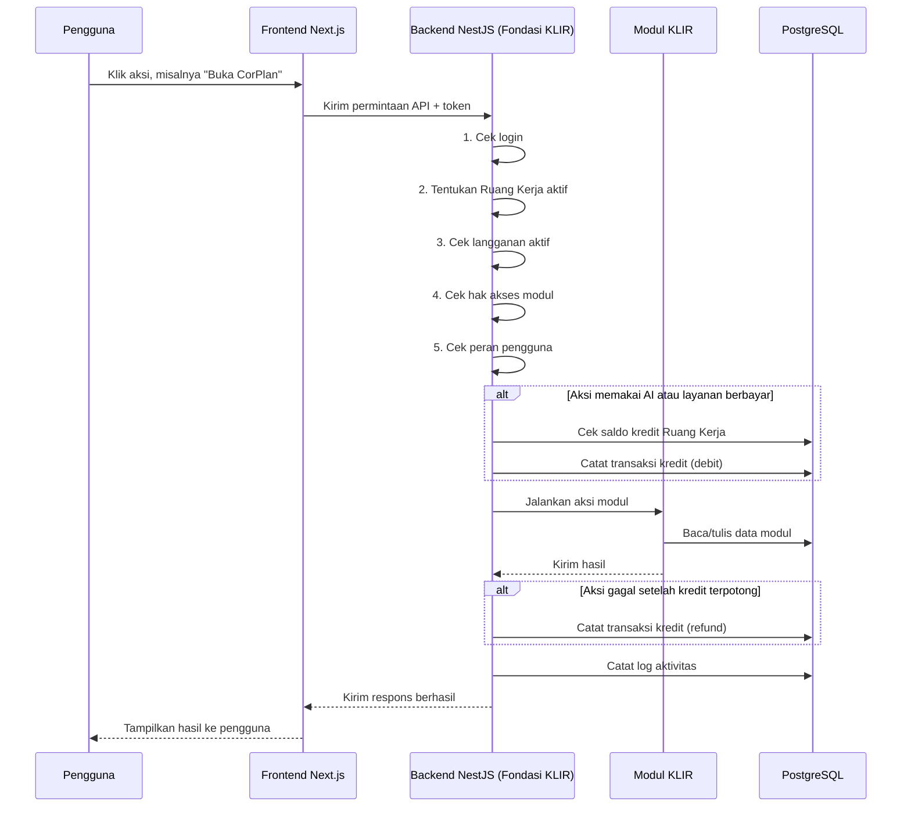
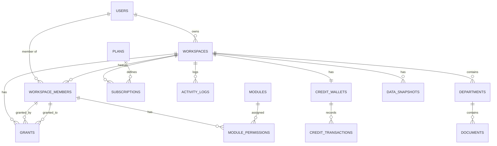

# PRD — Project Requirements Document

## 1. Overview

UMKM Indonesia seperti usaha katering milik Ibu Sari sering kali harus berpindah-pindah antara WhatsApp, catatan Excel, dan berbagai aplikasi yang tidak saling terhubung. Data yang sama dimasukkan berulang kali, dokumen usaha sulit dijelaskan ke pihak lain, dan tidak ada satu tempat untuk melihat kondisi usaha secara utuh.

KLIR hadir sebagai platform OS bisnis AI yang menyatukan semua kebutuhan UMKM dalam satu ekosistem. Modul-modul seperti CorPlan, AniVirtual, Repository Hukum, KLIR Kas, KLIR Promo, KLIR Kerja, dan KLIR Booking disambungkan seperti Lego di atas satu fondasi yang sama.

Fondasi ini bertanggung jawab atas:
- **Ruang Kerja multi-tenant** — satu pengguna bisa memiliki banyak usaha, masing-masing dengan data terpisah dan aman.
- **Alur permintaan terpusat** — setiap aksi melewati pemeriksaan login, Ruang Kerja, langganan, hak akses, peran, kredit, lalu dicatat sebagai log.
- **Sistem kredit** — pengguna tidak membayar per fitur, tetapi menggunakan kantong kredit yang diisi ulang sesuai paket.
- **Hak akses dua lapis** — peran fungsional plus akses granular ke departemen atau dokumen tertentu.
- **Data terhubung** — semua modul memakai satu sumber data, dengan salinan tetap untuk laporan dan dokumen selesai.

Tujuan utama fondasi ini adalah membuat semua modul KLIR bisa dibangun dan disambungkan tanpa mengulang pekerjaan dasar yang sama, sehingga pengalaman pengguna menjadi satu kesatuan yang mudah dipakai dan bisa diakses bersama oleh tim.

## 2. Requirements

- **Multi-tenant Ruang Kerja**: Setiap pengguna dapat memiliki banyak Ruang Kerja. Satu Ruang Kerja mewakili satu usaha dan datanya terisolasi dari Ruang Kerja lain.
- **Alur permintaan wajib**: Setiap permintaan dari pengguna harus melewati urutan: cek login → tentukan Ruang Kerja aktif → cek langganan → cek hak akses modul → cek peran pengguna → potong kredit bila aksi memakai AI atau layanan berbayar → jalankan aksi → catat log aktivitas.
- **Hak akses dua lapis**:
  - Lapis 1: peran fungsional — pemilik, anggota biasa, penyetuju.
  - Lapis 2: akses granular per departemen atau dokumen yang diberikan oleh penyetuju.
  - Aturan: penyetuju tidak boleh memberikan akses kepada dirinya sendiri.
- **Sistem kredit per Ruang Kerja**:
  - Paket Free: 100 kredit per hari.
  - Paket Starter: 2.000 kredit per minggu, batas 10.000 per bulan.
  - Paket Business: 8.000 kredit per minggu, batas 46.000 per bulan.
  - Riwayat kredit bersifat append-only, tidak pernah diubah atau dihapus. Pengembalian kredit karena kegagalan layanan dicatat sebagai baris baru.
- **Autentikasi akun**: Pendaftaran, masuk, keluar, dan reset kata sandi harus tersedia dan aman.
- **Log aktivitas**: Semua tindakan penting dalam Ruang Kerja tercatat, bisa dicari, dan bisa diekspor untuk audit.
- **Data terhubung**: Modul memakai satu sumber data yang sama. Data yang sering berubah dibaca langsung; data yang sudah final disalin sebagai snapshot yang tidak berubah.
- **Deployable di Railway** dengan PostgreSQL sebagai database utama.

## 3. Core Features

### Fase 1 — Dasbor Usaha
- **Dasbor Usaha** [high] — Halaman utama untuk melihat dan mulai bekerja dari satu Ruang Kerja aktif, lengkap dengan status, modul, kredit, dan aktivitas terbaru.
  - **Status Ruang** — Menampilkan ringkasan usaha, paket, dan Ruang Kerja yang sedang dipilih.
  - **Pintu Modul** — Langsung membuka modul-modul di dalam Ruang Kerja dari satu halaman utama.
  - **Sisa Kredit** — Melihat sisa kredit dan batas paket tanpa harus pindah halaman.
  - **Aktivitas Terbaru** — Menampilkan beberapa aktivitas terakhir yang terjadi di Ruang Kerja aktif.

### Fase 2 — Ruang Kerja
- **Ruang Kerja** [high] — Membuat dan mengelola beberapa Ruang Kerja yang terpisah, sehingga satu pengguna bisa menjalankan lebih dari satu usaha dengan data aman.
  - **Daftar Ruang** — Melihat semua Ruang Kerja yang dimiliki beserta status dan paketnya.
  - **Buat Ruang** — Membuat Ruang Kerja baru untuk usaha yang berbeda.
  - **Pindah Ruang** — Berpindah antar Ruang Kerja tanpa memasukkan data ulang.
  - **Pemisahan Data** — Menjaga data satu usaha tidak tertukar atau terbaca oleh usaha lain.

### Fase 3 — Data Terhubung dan Sistem Kredit
- **Data Terhubung** [medium] — Semua modul memakai satu sumber data yang sama, dengan salinan tetap untuk data penting dan data langsung yang selalu terbaru.
  - **Satu Sumber** — Modul yang berbeda memakai sumber data yang sama, jadi tidak perlu memasukkan data berulang.
  - **Salinan Tetap** — Data yang sudah jadi disalin sekali dan tidak lagi berubah, misalnya untuk laporan dan dokumen selesai.
  - **Baca Langsung** — Data yang sering berubah dibaca langsung oleh modul lain agar selalu terbaru.
  - **Jembatan Modul** — Modul dari ekosistem KLIR saling tertukar data tanpa mengandalkan alat yang terpisah.
- **Sistem Kredit** [high] — Mengelola kantong kredit Ruang Kerja yang dipakai bersama oleh semua modul, lengkap dengan riwayat dan pengembalian.
  - **Saldo Klien** — Melihat jumlah kredit yang masih tersisa dan batas paket saat ini.
  - **Riwayat Kredit** — Melihat semua pemotongan dan penambahan kredit yang tidak bisa diubah atau dihapus.
  - **Potongan Kredit** — Memotong kredit otomatis bila pengguna memakai fitur kecerdasan buatan atau layanan berbayar.
  - **Pengembalian Kredit** — Mengembalikan kredit ke kantong Ruang Kerja ketika layanan yang diminta gagal.

### Fase 4 — Paket dan Hak Akses
- **Paket & Upgrade** [high] — Memilih dan menaikkan paket Free, Starter, atau Business lengkap dengan alur pembayaran.
  - **Lihat Paket** — Menampilkan perbandingan paket beserta jatah kredit harian, mingguan, dan bulanan.
  - **Naik Paket** — Mengubah langganan ke paket yang lebih tinggi dan menyelesaikan pembayaran.
  - **Status Tagihan** — Melihat tagihan berjalan, status pembayaran, dan riwayat langganan.
- **Hak Akses & Peran** [high] — Memberikan peran kepada anggota Ruang Kerja dan mengatur hak akses khusus per departemen atau dokumen.
  - **Peran Anggota** — Menetapkan setiap orang sebagai pemilik, anggota, atau pemberi persetujuan.
  - **Hak Modul** — Mengatur modul apa saja yang boleh dipakai oleh tiap orang dalam Ruang Kerja.
  - **Akses Khusus** — Pemberi persetujuan dapat memberikan hak akses ke dokumen atau departemen tertentu.
  - **Tolak Akses Diri** — Mencegah pemberi persetujuan memberikan akses kepada diri sendiri.

### Fase 5 — Log Aktivitas dan Autentikasi Akun
- **Log Aktivitas** [medium] — Mencatat semua tindakan dalam Ruang Kerja dan membantu pengguna menelusuri apa yang terjadi.
  - **Riwayat Aktivitas** — Melihat semua aksi yang pernah terjadi di dalam Ruang Kerja berdasarkan urutan waktu.
  - **Cari Log** — Mencari catatan berdasarkan orang, modul, tanggal, atau status berhasil dan gagal.
  - **Ekspor Log** — Mengunduh log aktivitas untuk keperluan audit dan pencatatan.
- **Autentikasi Akun** [high] — Mendaftar, masuk, dan keluar dari akun dengan aman sebelum membuka Ruang Kerja.
  - **Daftar Akun** — Membuat akun baru untuk mulai menggunakan platform Ekosistem KLIR.
  - **Masuk dan Keluar** — Masuk ke akun dan mengakhiri sesi dengan aman.
  - **Reset Kata Sandi** — Mengembalikan akses akun ketika pengguna lupa kata sandi.

## 4. User Flow

### Alur Pengguna Baru — Kemenangan Pertama
1. Pengguna membuka aplikasi KLIR dan memilih **Daftar Akun**.
2. Pengguna mengisi email, nama, dan kata sandi.
3. Sistem membuat akun baru dan langsung mengarahkan pengguna ke halaman **Ruang Kerja**.
4. Pengguna memilih **Buat Ruang** dan mengisi nama usaha, misalnya “Katering Ibu Sari”.
5. Sistem membuat Ruang Kerja baru, lengkap dengan paket Free, kantong kredit harian, dan dasbor kosong.
6. Pengguna diarahkan ke **Dasbor Usaha** sebagai kemenangan pertama.
7. Pengguna melihat status usaha, pintu modul, sisa kredit, dan aktivitas terbaru.

### Alur Kerja Harian Pengguna
1. Pengguna **masuk** ke akun KLIR.
2. Sistem menampilkan daftar Ruang Kerja milik pengguna.
3. Pengguna memilih satu Ruang Kerja aktif, misalnya usaha katering.
4. Pengguna melihat **Dasbor Usaha** dengan ringkasan usaha dan sisa kredit.
5. Pengguna membuka modul yang diinginkan, misalnya CorPlan untuk membuat proposal.
6. Permintaan melewati pemeriksaan fondasi: login → Ruang Kerja → langganan → hak akses modul → peran.
7. Jika aksi memakai AI atau layanan berbayar, sistem memotong kredit dari kantong Ruang Kerja.
8. Aksi dijalankan dan hasilnya ditampilkan.
9. Seluruh aksi dicatat ke **Log Aktivitas**.

### Alur Upgrade Paket
1. Pengguna membuka halaman **Paket & Upgrade** dari dasbor.
2. Pengguna membandingkan paket Free, Starter, dan Business.
3. Pengguna memilih paket baru, misalnya Business.
4. Sistem menampilkan rincian harga dan jatah kredit.
5. Pengguna menyelesaikan pembayaran melalui gateway pembayaran.
6. Setelah pembayaran berhasil, status langganan berubah.
7. Sistem menambahkan jatah kredit sesuai paket baru ke kantong Ruang Kerja.
8. Pengguna melihat status tagihan dan riwayat langganan di halaman yang sama.

### Alur Pemberian Akses Khusus
1. Penyetuju membuka halaman **Hak Akses & Peran** di Ruang Kerja.
2. Penyetuju memilih anggota yang akan diberi akses khusus.
3. Penyetuju memilih target akses: departemen atau dokumen tertentu.
4. Penyetuju memilih tingkat akses yang diberikan.
5. Sistem memeriksa aturan: penyetuju tidak bisa memberikan akses kepada dirinya sendiri.
6. Jika valid, akses tersimpan dan langsung berlaku.
7. Aktivitas pemberian akses dicatat ke Log Aktivitas.

## 5. Architecture

Arsitektur KLIR menggunakan pola **fondasi terpusat**. Semua permintaan dari frontend masuk ke backend NestJS yang bertindak sebagai gerbang tunggal. Backend memeriksa semua kebutuhan dasar sebelum meneruskan aksi ke modul terkait.

Komponen utama:
- **Frontend Next.js** — antarmuka pengguna untuk Dasbor, Ruang Kerja, paket, dan pengaturan.
- **Backend NestJS (Fondasi KLIR)** — menangani autentikasi, Ruang Kerja, langganan, hak akses, kredit, log, dan penghubung modul.
- **Modul-modul KLIR** — CorPlan, AniVirtual, dan lainnya dipasang sebagai layanan yang mengikuti kontrak fondasi.
- **PostgreSQL** — database utama untuk semua data Ruang Kerja, pengguna, kredit, dan log.

Berikut alur permintaan terpusat:

Dengan arsitektur ini, setiap modul baru cukup mengikuti kontrak fondasi dan tidak perlu membangun ulang autentikasi, Ruang Kerja, kredit, atau log.

## 6. Database Schema

Skema database dirancang agar semua modul berbagi satu sumber data. Ada dua jenis data:

- **Data langsung (live data)** — data yang dibaca dan ditulis langsung oleh modul, selalu terbaru. Contoh: data Ruang Kerja, anggota, dokumen aktif, dan saldo kredit.
- **Data snapshot (salinan tetap)** — data yang disalin sekali pada suatu waktu dan tidak berubah lagi. Contoh: laporan selesai, dokumen final, atau hasil generate yang diarsipkan.

### Tabel Utama

**users**
- `id` (uuid, primary key) — identitas unik pengguna.
- `email` (text, unique) — alamat email untuk login.
- `password_hash` (text) — kata sandi yang sudah dienkripsi.
- `name` (text) — nama lengkap pengguna.
- `created_at` (timestamp) — waktu pendaftaran.

**workspaces**
- `id` (uuid, primary key) — identitas unik Ruang Kerja.
- `owner_id` (uuid, foreign key ke users) — pemilik Ruang Kerja.
- `name` (text) — nama usaha.
- `business_type` (text) — jenis usaha, misalnya katering.
- `created_at` (timestamp) — waktu pembuatan.

**workspace_members**
- `id` (uuid, primary key) — identitas unik keanggotaan.
- `workspace_id` (uuid, foreign key ke workspaces) — Ruang Kerja tempat anggota terdaftar.
- `user_id` (uuid, foreign key ke users) — pengguna yang menjadi anggota.
- `role` (enum: owner, member, approver) — peran fungsional.
- `joined_at` (timestamp) — waktu bergabung.

**modules**
- `id` (uuid, primary key) — identitas unik modul.
- `code` (text, unique) — kode modul, misalnya `corplan`.
- `name` (text) — nama modul.
- `description` (text) — penjelasan singkat modul.

**module_permissions**
- `id` (uuid, primary key) — identitas unik hak modul.
- `workspace_member_id` (uuid, foreign key ke workspace_members) — anggota yang diatur haknya.
- `module_id` (uuid, foreign key ke modules) — modul yang diizinkan.
- `allowed` (boolean) — true jika boleh memakai modul.

**departments**
- `id` (uuid, primary key) — identitas unik departemen.
- `workspace_id` (uuid, foreign key ke workspaces) — Ruang Kerja pemilik departemen.
- `name` (text) — nama departemen, misalnya Produksi atau Keuangan.

**documents**
- `id` (uuid, primary key) — identitas unik dokumen.
- `workspace_id` (uuid, foreign key ke workspaces) — Ruang Kerja pemilik dokumen.
- `department_id` (uuid, foreign key ke departments) — departemen terkait.
- `title` (text) — judul dokumen.
- `content` (text) — isi dokumen.
- `status` (text) — status dokumen, misalnya draft, final, atau disetujui.

**grants**
- `id` (uuid, primary key) — identitas unik pemberian akses.
- `workspace_id` (uuid, foreign key ke workspaces) — Ruang Kerja tempat akses diberikan.
- `granted_by` (uuid, foreign key ke workspace_members) — penyetuju yang memberikan akses.
- `granted_to` (uuid, foreign key ke workspace_members) — anggota yang menerima akses.
- `target_type` (enum: department, document) — jenis target akses.
- `target_id` (uuid) — id departemen atau dokumen tujuan.
- `permission` (text) — tingkat akses, misalnya lihat atau ubah.
- `created_at` (timestamp) — waktu pemberian.
- Aturan: `granted_by` tidak boleh sama dengan `granted_to`.

**plans**
- `id` (uuid, primary key) — identitas unik paket.
- `code` (text, unique) — kode paket: `free`, `starter`, `business`.
- `name` (text) — nama paket.
- `daily_credit` (integer) — jatah kredit per hari, untuk Free.
- `weekly_credit` (integer) — jatah kredit per minggu, untuk Starter dan Business.
- `monthly_limit` (integer) — batas kredit per bulan.
- `price` (integer) — harga langganan dalam rupiah.

**subscriptions**
- `id` (uuid, primary key) — identitas unik langganan.
- `workspace_id` (uuid, foreign key ke workspaces) — Ruang Kerja yang berlangganan.
- `plan_id` (uuid, foreign key ke plans) — paket yang dipilih.
- `status` (enum: active, past_due, canceled) — status langganan.
- `current_period_start` (timestamp) — awal periode berjalan.
- `current_period_end` (timestamp) — akhir periode berjalan.

**credit_wallets**
- `id` (uuid, primary key) — identitas unik kantong kredit.
- `workspace_id` (uuid, foreign key ke workspaces, unique) — satu Ruang Kerja punya satu kantong kredit.
- `balance` (integer) — sisa kredit saat ini.
- `updated_at` (timestamp) — waktu terakhir diperbarui.

**credit_transactions**
- `id` (uuid, primary key) — identitas unik transaksi kredit.
- `workspace_id` (uuid, foreign key ke workspaces) — Ruang Kerja pemilik transaksi.
- `user_id` (uuid, foreign key ke users) — pengguna yang memicu transaksi.
- `amount` (integer) — jumlah kredit; negatif untuk pemotongan, positif untuk pengisian atau pengembalian.
- `type` (enum: debit, credit, refund) — jenis transaksi.
- `reference_id` (text) — referensi aksi atau modul terkait.
- `description` (text) — keterangan transaksi.
- `created_at` (timestamp) — waktu transaksi.
- Catatan: tabel ini **append-only**, tidak boleh ada update atau delete. Pengembalian kredit ditambahkan sebagai baris baru dengan tipe `refund`.

**activity_logs**
- `id` (uuid, primary key) — identitas unik log.
- `workspace_id` (uuid, foreign key ke workspaces) — Ruang Kerja tempat aksi terjadi.
- `user_id` (uuid, foreign key ke users) — pengguna yang melakukan aksi.
- `module_code` (text) — modul terkait.
- `action` (text) — jenis aksi, misalnya `create_proposal`.
- `status` (enum: success, failed) — hasil aksi.
- `metadata` (json) — data tambahan aksi.
- `created_at` (timestamp) — waktu aksi.

**data_snapshots**
- `id` (uuid, primary key) — identitas unik snapshot.
- `workspace_id` (uuid, foreign key ke workspaces) — Ruang Kerja pemilik snapshot.
- `source_type` (text) — jenis sumber, misalnya `laporan` atau `dokumen`.
- `source_id` (uuid) — id data asal sebelum disalin.
- `snapshot_data` (json) — isi data yang disalin.
- `created_at` (timestamp) — waktu snapshot dibuat.
- Catatan: snapshot tidak pernah diubah setelah dibuat.

### Diagram ER

## 7. Tech Stack

- **Frontend**: Next.js, Tailwind CSS, dan shadcn/ui untuk membangun antarmuka yang cepat dan konsisten.
- **Backend**: NestJS sebagai API utama sekaligus fondasi yang menangani autentikasi, Ruang Kerja, langganan, hak akses, kredit, dan log aktivitas.
- **Database**: PostgreSQL sebagai database utama.
- **ORM**: Prisma ORM untuk mengelola skema database dan relasi antar tabel.
- **Autentikasi**: JWT Access Token dan Refresh Token yang dikelola oleh NestJS.
- **Deployment**: Railway untuk backend, frontend, dan database PostgreSQL.
- **AI Provider / Gateway**: InsForge Model Gateway (OpenRouter) sebagai penyedia model AI untuk fitur kecerdasan buatan di semua modul.
- **Pembayaran**: Gateway pembayaran seperti Midtrans atau Xendit untuk menangani upgrade paket dan status tagihan.